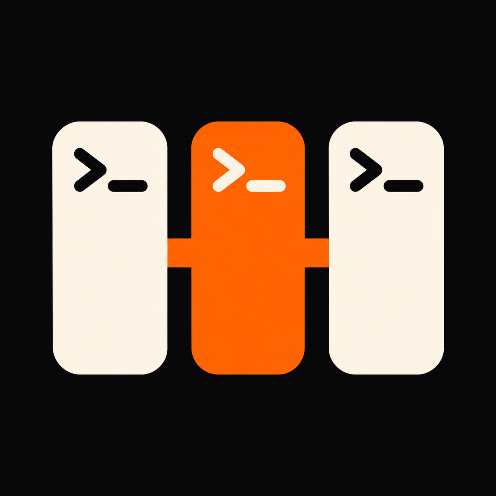

<p align="center">
  
</p>

<h1 align="center">Herdr Team</h1>

<p align="center"><em>One plan. A team you can watch.</em></p>

<p align="center">
  
  
  <a href="LICENSE"></a>
</p>

Your master agent plans and reviews. Implementers work in their own Herdr tabs.
You see the work, approve the plan, and decide when it ships.

## Install

You need **Herdr desktop**, `hc` and `herdr-app` on your PATH, and an authenticated
**Codex** or **Claude Code** CLI. Use a local session inside Herdr.

### Codex

```sh
codex plugin marketplace add pcodez99/herdr-skills
codex plugin add herdr@herdr-skills
```

Check it with `codex plugin list --marketplace herdr-skills`.

### Claude Code

```sh
claude plugin marketplace add pcodez99/herdr-skills
claude plugin install herdr@herdr-skills
```

Check it with `claude plugin list`. Both plugins include the skill; no separate
symlink is needed. Start a new session after installing.

| What you get | Codex | Claude Code |
| --- | --- | --- |
| `herdr-team` skill | Yes | Yes |
| Session-start reminder inside Herdr | — | Yes |
| Local execution required | Yes | Yes |

Updating from the older hook-only Claude plugin? Update the plugin, then remove
your old `herdr-team` symlink after confirming it is a symlink. The plugin now
includes the skill itself.

<details>
<summary>Prefer the skill without a plugin?</summary>

Clone the repository and link the skill into your agent's skill directory:

```sh
git clone https://github.com/pcodez99/herdr-skills.git
cd herdr-skills
mkdir -p "$HOME/.claude/skills"
ln -s "$PWD/skills/herdr-team" "$HOME/.claude/skills/herdr-team"
```

For Codex, replace `.claude` with `.codex`. Keep the clone in place. Check an
existing destination before replacing it, and choose either the plugin or the
symlink to avoid loading the skill twice.

</details>

## Put the team to work

> Use herdr-team to plan and implement this task with a team of agents in Herdr.

1. The master proposes a plan and a team sized to the task.
2. You approve. Agents start in separate, visible tabs.
3. The master reviews the changes and runs the checks.
4. You authorize commits, pushes, and closing the team's tabs.

Agents use your existing provider accounts and permissions. Provider usage may
incur costs. The package does not install Herdr or run in cloud-only chats.
The official CLI manuals come from `hc --skill` and `herdr-app --skill`.

## Small package. Clear boundaries.

- [The skill](skills/herdr-team/SKILL.md) — planning, ownership, gates, and handoffs.
- [Troubleshooting](skills/herdr-team/TROUBLESHOOTING.md) — when an agent gets stuck.
- [Publishing](docs/PUBLISHING.md) — checks, ZIPs, and directory submission steps.
- [Privacy](PRIVACY.md) · [Support](https://github.com/pcodez99/herdr-skills/issues) · [MIT license](LICENSE).

By **[pcodez](https://github.com/pcodez99)**. An independent skill package for Herdr;
not an official Herdr, OpenAI, or Anthropic product. Repository installation is
available now; official directory listings require separate review and approval.
